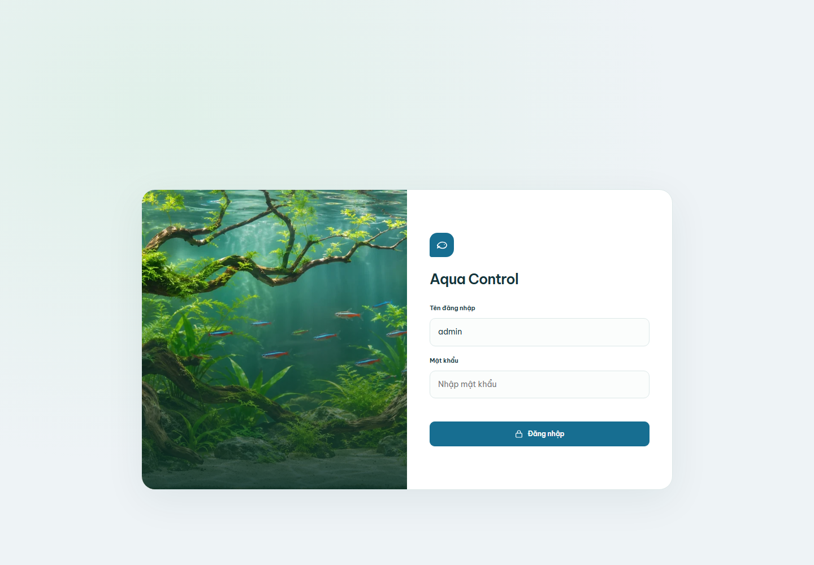
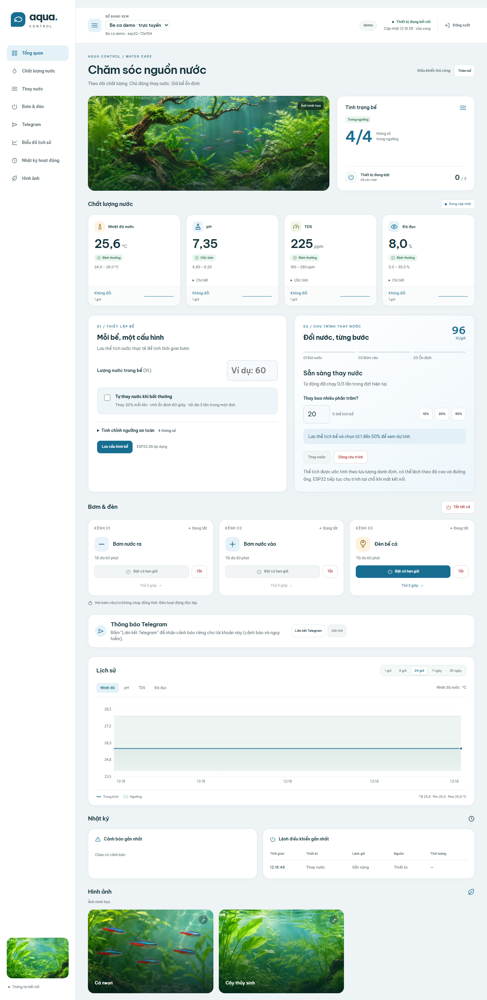
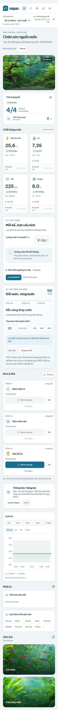
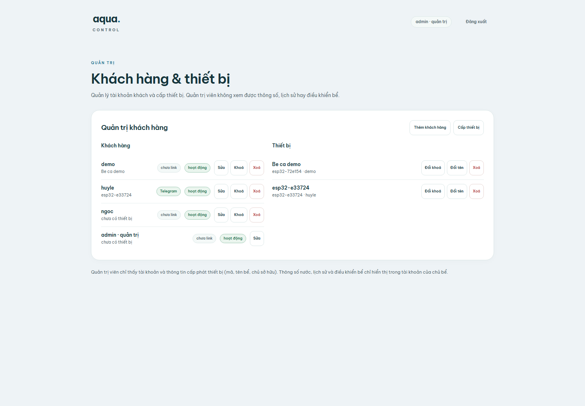

# BÁO CÁO KIỂM THỬ — AQUA-CONTROL

- Ngày chạy phần mềm: **24/11/2026, 12:11 (+07:00)**
- Máy: **Windows 11 Pro 10.0.26200**, Node **24.12.0**, npm **11.21.2**
- Mã nguồn: nhánh `main`, commit **a904094**
- Thư mục chạy: `D:\Opencode Workspace\IOT\Aqua-Control`
- Log đầy đủ: `docs/ket-qua-kiem-thu-20261124-121140.log`
- Lệnh chạy lại tất cả + in bảng tổng kết để chụp màn hình:

```powershell
pwsh -NoProfile -ExecutionPolicy Bypass -File tools\run-all-tests.ps1
```

> **Lưu ý quan trọng trước khi nộp:** hồ sơ bàn giao ghi "phiên bản 4.0.0", nhưng mã nguồn trong thư mục này là firmware **3.3.0-explicit-ph-calibration**, `package.json` version **1.0.0**, và **không có** tính năng lịch đèn / giữ ấm (`water.lighting`) lẫn script `test:lighting`. Vì vậy mục "Lịch và giữ ấm" và toàn bộ bảng nghiệm thu đèn **chưa thể điền** cho tới khi có đúng bản mã 4.0. Xem mục 4.

---

## 1. Kết quả kiểm thử phần mềm (đã chạy lại, điền được ngay)

| Hạng mục | Lệnh | Kết quả thực tế 24/11/2026 | Thời gian |
|---|---|---|---|
| MQTT, Web, SQLite/SSE, migration, relay gating | `npm.cmd test` | **ĐẠT** — 1/1 test, 0 fail | 10,0 s |
| Đa khách hàng (đăng nhập, khoá thiết bị, MQTT, lệnh bơm) | `npm.cmd run test:multi` | **ĐẠT** — 27/27 kiểm tra | 2,7 s |
| Quyền tài khoản quản trị (tạo user/thiết bị, không đọc telemetry) | `npm.cmd run test:admin` | **ĐẠT** — 1/1 test, 0 fail | 1,9 s |
| Chu trình thay nước (cài đặt, đồng bộ, lưu lượng, ACK, huỷ, mô phỏng, lưu DB) | `npm.cmd run test:water` | **ĐẠT** — 1/1 test, 0 fail | 5,8 s |
| Telegram — kế hoạch cảnh báo (chống spam, nhắc lại, mức vàng/đỏ) | `npm.cmd run test:telegram` | **ĐẠT** — 8/8 test | 1,2 s |
| Telegram — lệnh điều khiển (quyền sở hữu, giới hạn, offline) | `npm.cmd run test:telegram-control` | **ĐẠT** — 1/1 test, 0 fail | 2,3 s |
| Telegram đầu-cuối (MQTT → bot → chat, tắt/bật thông báo) | `npm.cmd run test:e2e` | **ĐẠT** — 9/9 ca; gửi 6 cảnh báo, tổng 10 tin | 10,5 s |
| Kiểm tra tĩnh giao diện | `npm.cmd run check:ui` | **ĐẠT** — 39 id DOM khớp, 22 lớp CSS, 23 route API khớp | 0,7 s |
| Logic C++ trên máy tính (g++, qua WSL Debian 14.2.0) | `npm.cmd run test:firmware`¹ | **ĐẠT** — `PASS: firmware water phases, flow, auto limits, abort/reboot/overflow, calibration` | 2,8 s |
| Build ESP32 | `pio run -e esp32dev` | **BỎ QUA** — máy này không cài PlatformIO | — |
| Lịch + giữ ấm trên simulator | `npm.cmd run test:lighting` | **BỎ QUA** — script không tồn tại (xem mục 4) | — |

**Tổng: 9/9 hạng mục chạy được đều ĐẠT; 2 hạng mục bỏ qua vì thiếu công cụ/tính năng.**

¹ Trên Windows không có `g++`, script tự chuyển sang WSL Debian:
`g++ -std=c++14 -Wall -Wextra tests/water-change.test.cpp -o .tooling/water-test-linux && ./.tooling/water-test-linux`.
Muốn chạy đúng lệnh `npm.cmd run test:firmware` trên Windows: cài MinGW-w64 rồi đặt biến `CXX` trỏ tới `g++.exe`.
Bài test C++ gồm: pha rút/cấp/chờ ổn định, lưu lượng 96 L/h, giới hạn 3 lần tự động, huỷ giữa pha, phục hồi sau mất nguồn, chống tràn và hiệu chuẩn pH.

### Build ESP32 — số liệu lấy từ hồ sơ bàn giao (chưa chạy lại được tại máy này)

| Chỉ số | Giá trị hồ sơ | Ghi chú |
|---|---|---|
| Môi trường | PlatformIO `esp32dev` | Cần `pip install platformio` để tái lập |
| Flash dùng | 962.501 byte (73,4 %) | |
| RAM tĩnh | 49.688 byte (15,2 %) | |

Muốn có ảnh Terminal của mục này: cài PlatformIO rồi chạy `pio run -e esp32dev`, chụp dòng `RAM:` / `Flash:` ở cuối. Nếu nhóm đã có build của bản 4.0.0 thì dùng log build đó, **không** dùng số của bản 3.3.0 trong thư mục này.

---

## 2. Ảnh giao diện (đã chụp ngày 24/11/2026, 12:18–12:24)

Chụp bằng **Chrome headless thật** (không phải ảnh dựng) từ bản triển khai Azure `http://20.249.9.173`, đăng nhập qua API, chụp toàn trang, `pageErrors = []`.





| Ảnh | Nội dung | Dùng cho mục |
|---|---|---|
| `docs/screenshots/ket-qua/terminal-tests.png` | Cửa sổ Terminal thật, chạy 11 lệnh, khung TỔNG KẾT 9/9 ĐẠT | "Kết quả chạy kiểm thử phần mềm" (Chương 4) |
| `docs/screenshots/ket-qua/terminal-tests-summary.png` | Bản cắt khung TỔNG KẾT cho dễ đọc khi chèn Word | nt |
| `docs/screenshots/ket-qua/login.png` | Trang đăng nhập | Minh chứng giao diện |
| `docs/screenshots/ket-qua/dashboard-desktop.png` | Dashboard đủ 4 chỉ số (25,6 °C · pH 7,35 · 225 ppm · 8,0 %), 3 kênh relay, biểu đồ lịch sử | "Dữ liệu Serial và dashboard" + "Kết quả chạy kiểm thử" |
| `docs/screenshots/ket-qua/dashboard-mobile.png` | Cùng dashboard ở 390 px | Kiểm tra responsive |
| `docs/screenshots/ket-qua/admin.png` | Trang quản trị: tạo khách hàng, cấp thiết bị, **không có** số đo bể | Minh chứng phân quyền |

> ⚠️ Bốn ảnh trên lấy từ **thiết bị mô phỏng** (`tools/simulate-device.js`, tài khoản `demo` đã xoá sau khi chụp), không phải bể thật. Ghi chú ảnh đúng: *"Giao diện chạy trên bản triển khai Azure, số đo do thiết bị mô phỏng gửi lên."*
> Ảnh **số đo thật** vẫn phải do người cầm ESP32 chụp — xem mục 3.5.

Thiết bị thật `esp32-e33724` (chủ tài khoản `huyle`) **đang offline từ 13/11/2026 08:09 (giờ VN)** — lần cuối nhận số đo là `2026-11-13T01:09:07Z`, firmware `3.3.0-explicit-ph-calibration`. Vì vậy hiện **không có dữ liệu bể thật** để chụp; khi cắm lại ESP32 (firmware vẫn trỏ Azure) hoặc sau khi bạn cấp tài khoản/mật khẩu `huyle`, có thể chụp lại dashboard bằng đúng lệnh trên và thay bộ ảnh mô phỏng.





Chạy lại để chụp bộ ảnh mới (thay `--base`/tài khoản của bạn):

```powershell
# Thiết bị mô phỏng phải đang chạy trước, ví dụ:
node tools/simulate-device.js --device <DEVICE_ID> --key <DEVICE_KEY> --url mqtt://20.249.9.173:1883

# Rồi chụp:
node tools/capture-shots.mjs --base http://aqua.test --host-ip 20.249.9.173 `
  --username <tài khoản khách> --password <mật khẩu> `
  --admin-user admin --admin-pass beca123 --out docs/screenshots/ket-qua
```

Vì sao dùng `aqua.test` thay vì IP: Chrome trên máy này chặn URL `http://20.249.9.173` (`ERR_BLOCKED_BY_CLIENT` — bộ lọc của máy/trình duyệt), nên script dùng `--host-resolver-rules` trỏ tên `aqua.test` về IP thật. Với máy khác không bị chặn thì dùng thẳng `--base http://20.249.9.173` và bỏ `--host-ip`.

---

## 3. Phần cứng & số đo thực tế — checklist cho người cầm ESP32

Gửi nguyên mục này cho bạn bạn. Mỗi bước ghi **ngày giờ**, chụp màn hình Serial Monitor (115200 baud) và ảnh tải thử.

### 3.1. Thử relay bằng Serial Monitor (cần 4 ảnh)

1. Cắm ESP32, mở Serial Monitor **115200**.
2. Gõ `t1` → chờ đủ **3 giây** (kênh tự tắt) → chụp log + ảnh tải/bơm thực tế đang chạy.
3. Gõ `t2` → chờ 3 giây → chụp.
4. Gõ `t3` → chờ 3 giây → chụp.
5. Gõ `status` → chụp (thấy `IN1..IN3: ON/OFF`).
6. Gõ `off` → chụp trạng thái tất cả OFF.

Ghi vào chú thích ảnh: kênh nào thực sự đóng, tải gì, thời điểm.

| Kênh | Lệnh | Tải thực tế | Đóng/ngắt đúng? | Giờ chụp |
|---|---|---|---|---|
| IN1 — bơm tăng pH | `t1` | | ☐ Có ☐ Không | |
| IN2 — bơm hạ pH | `t2` | | ☐ Có ☐ Không | |
| IN3 — đèn bể cá | `t3` | | ☐ Có ☐ Không | |
| Tất cả | `off` | — | ☐ Có ☐ Không | |

### 3.2. Đo cảm biến (cần 2–3 ảnh)

1. **Dừng bơm** trước khi đo (`off`).
2. Gõ `sensors` → chụp log (nhiệt độ, pH, TDS, độ đục + điện áp OUT).
3. Gõ `phstatus` → chụp (chế độ pH, hệ số hiệu chuẩn).
4. Nếu có dung dịch chuẩn:
   - Nhúng đầu dò pH 7,00 → gõ `ph7`, chờ ổn định.
   - Rửa bằng nước cất → nhúng pH 4,00 → gõ `ph4`, chờ ổn định.
   - Gõ `phstatus`, rồi `phmode calibrated`, đo lại mẫu thật.
5. Chụp dashboard lúc này (đủ 4 chỉ số).

| Thông số | ESP32 đọc | Thiết bị/mẫu đối chiếu | Sai lệch | Ghi chú |
|---|---|---|---|---|
| Nhiệt độ (°C) | | Nhiệt kế: | | |
| pH | | Dung dịch pH 7,00 / 4,00 | | Chế độ: `phstatus` = …… |
| TDS (ppm) | | Bút đo TDS / mẫu pha sẵn | | Kèm nhiệt độ lúc đo |
| Độ đục (% tương đối) | | Mẫu trong / mẫu đục | | Ghi `OUT (V)` = …… |

### 3.3. Lưu lượng bơm và thay nước (cần 2 ảnh)

Đo riêng từng bơm với đúng chiều cao/ống lúc lắp: hứng nước vào can có chia vạch, bấm giờ.

`Q (L/h) = 3600 × V (L) / t (s)`

| Ca | Thao tác | Kết quả |
|---|---|---|
| Bơm rút | …… L trong …… s | …… L/h |
| Bơm cấp | …… L trong …… s | …… L/h |

- **Thay nước thủ công:** nhập thể tích bể trên Web, chờ "ESP32 đã áp dụng", chọn tỷ lệ nhỏ (VD 10 %) → chụp lúc pha rút, pha cấp và lúc chờ ổn định. Ghi `%`, số lít rút/cấp thực tế.
- **Thay nước tự động:** chỉ thử trên bể kiểm thử có người trông. Tạo tình huống vượt ngưỡng, ghi pha, %, số lần thử (tối đa 3), thời điểm đánh giá lại.
- **Dừng giữa pha:** bấm dừng, ghi trạng thái (`error`, có/không yêu cầu xác nhận mực nước). Nếu thử mất nguồn: rút điện giữa pha, bật lại, ghi trạng thái và **kiểm tra mực nước trước khi đặt lại**.

| Ca | Kết quả thực tế | Giờ |
|---|---|---|
| Thay nước thủ công | …… % / …… L rút / …… L cấp | |
| Thay nước tự động | ☐ Đã thử: …… | |
| Dừng giữa pha / mất nguồn | | |

### 3.4. Telegram (cần 1 ảnh, che mã liên kết + token)

1. Trên Web lấy **mã liên kết**.
2. Trong bot: `/start <mã>` → `/be` → `/cam_bien` → `/nuoc`.
3. Trên Web bấm **Gửi thử**.
4. Nếu có ca vượt ngưỡng: chụp thêm tin cảnh báo.

Ảnh cần thấy: tin nhắn bot trả lời + nút/nội dung, **che mã liên kết, token, chat id**.

### 3.5. Danh sách ảnh tối thiểu gửi lại

1. Serial `t1` + tải thử
2. Serial `t2` + tải thử
3. Serial `t3` + tải thử
4. Serial `status` và `off`
5. Serial `sensors` + `phstatus`
6. Dashboard 4 chỉ số (dữ liệu thật)
7. Màn hình Telegram đã liên kết + tin "Gửi thử"
8. (Nếu làm) chu trình thay nước: pha rút, pha cấp, chờ ổn định

---

## 4. Phần "Lịch đèn và giữ ấm" — đang bị chặn

Đối chiếu mã nguồn ngày 24/11/2026:

- `package.json` **không có** script `test:lighting`.
- Toàn bộ repo **không có** chuỗi `lighting`, `clockValid`, `manualOverride`, `schedule` cho đèn (chỉ có lịch chạy nội bộ của Telegram).
- `/api/state` trả về `params`, `pumps`, `water`, `telegram`… **không có** `water.lighting`.
- Firmware chỉ bật/tắt đèn bằng lệnh MQTT có hẹn giờ (`/den bat <giây>`), không có lịch theo giờ hay ngưỡng nhiệt độ.

⇒ Không thể chạy `test:lighting`, không thể điền bảng "Kết quả nghiệm thu hai chế độ đèn tự động", và không có API để ghi `clockValid / scheduled / heating / manualOverride / source`. Cần một trong hai:

1. **Lấy đúng bản mã 4.0.0** (bản có lịch đèn + giữ ấm) từ nhóm, đặt vào thư mục này rồi tôi chạy lại toàn bộ; hoặc
2. **Bổ sung tính năng** lịch đèn + giữ ấm (server + dashboard + test) — việc này là phát triển mới, không phải kiểm thử.

Nếu bỏ mục này khỏi hồ sơ, ghi rõ: *"Bản mã trong kho chưa có tính năng lịch đèn/giữ ấm; mục nghiệm thu đèn không áp dụng cho phiên bản 1.0.0."*

---

## 5. Hai lỗi cần xử lý trước khi nộp

1. **`tests/` đang bị `.gitignore`** (mục `# Tests` / `tests/`). Người chấm clone repo sẽ không thấy bài test, không tái lập được bảng kết quả. Nên bỏ dòng đó và commit thư mục `tests/`.
2. **Bản Railway đã chết:** `https://aqua-control-production.up.railway.app` trả `404 Application not found` (kiểm tra 24/11/2026 12:08). Bản Azure `http://20.249.9.173` vẫn chạy (`{"ok":true,"brokerConnected":true}`). Nếu hồ sơ có ghi link Railway thì đổi sang Azure hoặc dựng lại Railway.
