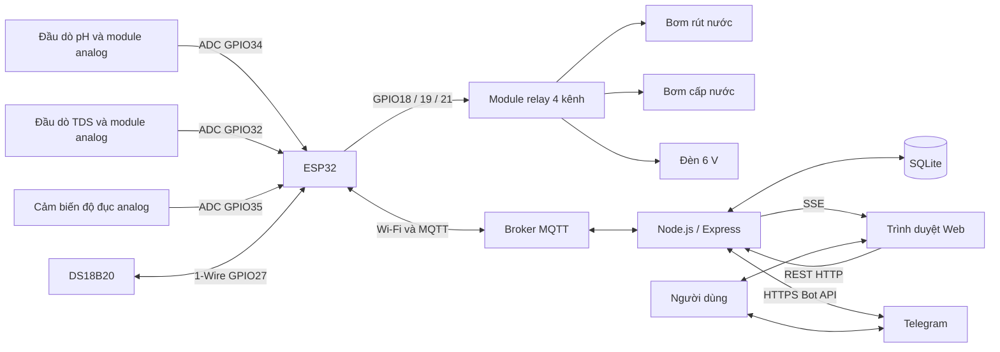
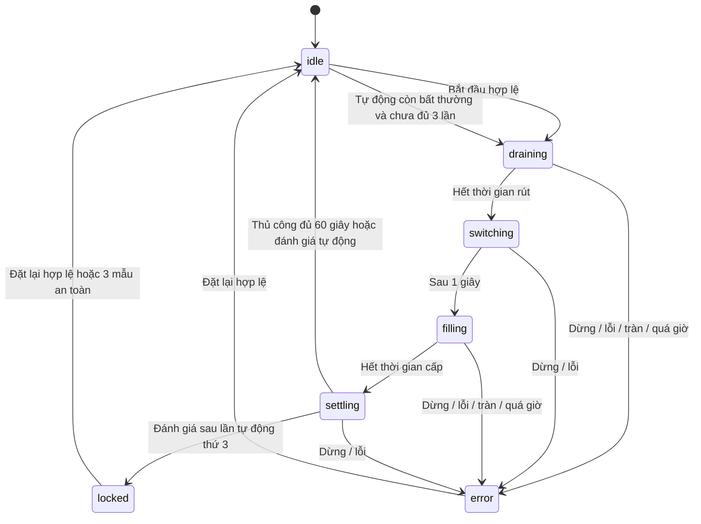
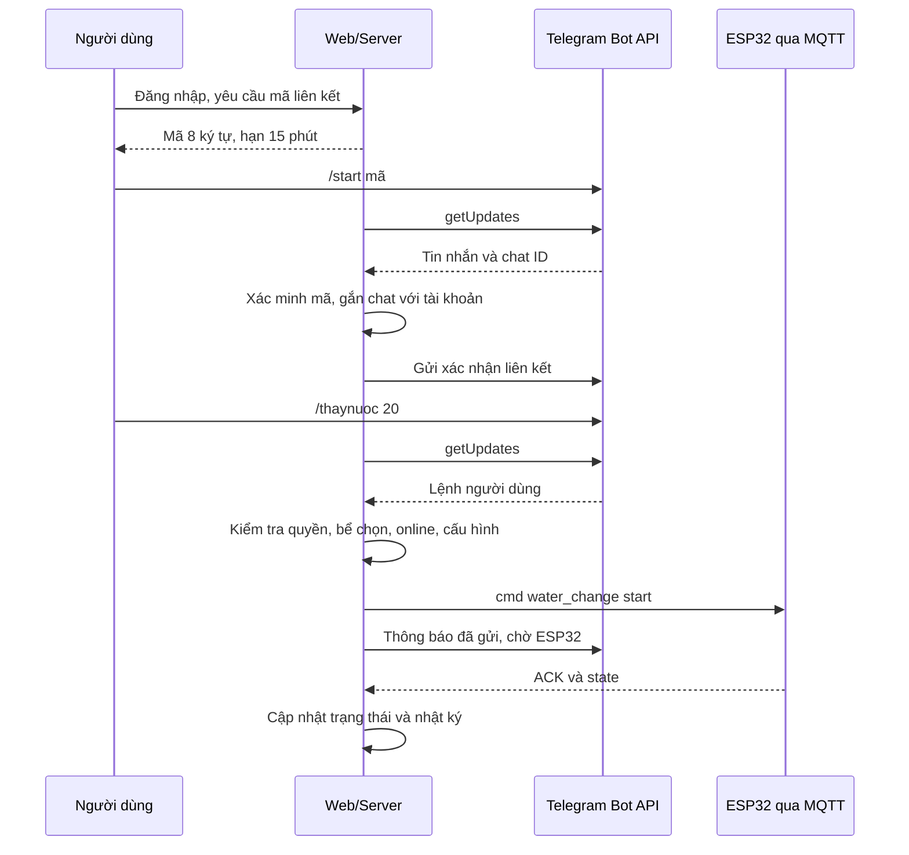

# BÁO CÁO KỸ THUẬT HỆ THỐNG AQUA CONTROL

**Đề tài:** Hệ thống IoT giám sát chất lượng nước và điều khiển bể cá bằng ESP32, Web và Telegram.  
**Ngày lập:** 13/11/2026.  
**Căn cứ:** Mã nguồn trong dự án Aqua-Control tại thời điểm lập báo cáo.  
**Firmware được khai báo trong mã:** `4.0.0`.

> Báo cáo phiên bản 4.0 mô tả hệ thống hai bơm rút/cấp nước, đèn theo lịch và theo nhiệt độ. Sơ đồ đấu nối được thể hiện theo cấu hình firmware. Thông tin xác thực triển khai được giữ trong cấu hình riêng.

## Mục lục

1. [Tổng quan](#1-tổng-quan)
2. [Kiến trúc hệ thống](#2-kiến-trúc-hệ-thống)
3. [Các chức năng](#3-các-chức-năng)
4. [Linh kiện và thiết bị](#4-linh-kiện-và-thiết-bị)
5. [Sơ đồ mạch và đấu nối](#5-sơ-đồ-mạch-và-đấu-nối)
6. [Đo lường và xử lý dữ liệu](#6-đo-lường-và-xử-lý-dữ-liệu)
7. [Điều khiển và thay nước](#7-điều-khiển-và-thay-nước)
8. [Giao thức truyền thông](#8-giao-thức-truyền-thông)
9. [Kết nối và điều khiển Telegram](#9-kết-nối-và-điều-khiển-telegram)
10. [Phần mềm và cơ sở dữ liệu](#10-phần-mềm-và-cơ-sở-dữ-liệu)
11. [Xác thực và phân quyền](#11-xác-thực-và-phân-quyền)
12. [Triển khai và vận hành](#12-triển-khai-và-vận-hành)
13. [Kiểm thử và nghiệm thu](#13-kiểm-thử-và-nghiệm-thu)
14. [Đặc tính vận hành và mở rộng](#14-đặc-tính-vận-hành-và-mở-rộng)
15. [Tài liệu mã nguồn đối chiếu](#15-tài-liệu-mã-nguồn-đối-chiếu)

## 1. Tổng quan

Aqua Control là hệ thống giám sát và điều khiển bể cá qua mạng. ESP32 thu thập nhiệt độ nước, pH, TDS và tín hiệu độ đục; điều khiển relay nối với hai bơm và đèn. Máy chủ Node.js tiếp nhận dữ liệu qua MQTT, lưu SQLite, cung cấp giao diện Web và kết nối Telegram.

Hệ thống phục vụ nhiều tài khoản khách hàng, mỗi tài khoản có thể sở hữu nhiều bể. Mỗi thiết bị có danh tính và khóa MQTT riêng. Đèn có lịch hằng ngày và điều khiển giữ ấm theo DS18B20, lưu cấu hình tại ESP32. Người dùng có thể theo dõi số đo, xem lịch sử, đặt ngưỡng, bật/tắt tải có hẹn giờ và yêu cầu thay nước theo tỷ lệ thể tích.

Chức năng tự thay nước chạy tại ESP32 khi đã được người dùng bật và cấu hình hợp lệ. Mặc định ban đầu chế độ tự động tắt, thể tích bể chưa thiết lập. Bơm không châm hóa chất điều chỉnh pH; thay nước là tác động vật lý được triển khai để phản ứng với thông số bất thường.

Các giá trị pH tính theo tham chiếu, TDS theo mô hình và độ đục tương đối cần được hiểu đúng nguồn gốc. Dự án chưa cung cấp bằng chứng đo đối chứng để công bố sai số của toàn hệ thống.

## 2. Kiến trúc hệ thống

### 2.1. Sơ đồ khối



### 2.2. Các tầng xử lý

| Tầng | Thành phần | Vai trò |
|---|---|---|
| Đo lường | DS18B20, pH, TDS, độ đục | Chuyển đại lượng trong nước thành tín hiệu số hoặc điện áp |
| Thiết bị | ESP32 và firmware Arduino | Đọc cảm biến, tính toán, điều khiển GPIO, hẹn giờ, thực hiện chu trình thay nước |
| Truyền thông | Wi-Fi, TCP/IP, MQTT | Chuyển telemetry, trạng thái, cấu hình, lệnh và ACK |
| Máy chủ | Node.js, Express, Aedes, MQTT.js | Xác thực, xử lý dữ liệu, kiểm tra quyền, cung cấp API và bot |
| Lưu trữ | SQLite; NVS trên ESP32 | Lưu lịch sử, cấu hình, hiệu chuẩn và chốt chu trình |
| Tương tác | Web, Telegram, Serial | Theo dõi, cấu hình, điều khiển và chẩn đoán |

Luồng giám sát: **cảm biến → ESP32 → MQTT → máy chủ → SQLite/Web/Telegram**. Luồng điều khiển: **Web hoặc Telegram → kiểm tra quyền trên máy chủ → MQTT → ESP32 → relay → trạng thái/ACK trở lại**.

Máy chủ mặc định cung cấp HTTP cổng `3000` và broker MQTT TCP cổng `1883`. Broker được nhúng trong tiến trình Node.js; có thể chuyển sang broker ngoài bằng cấu hình môi trường.

## 3. Các chức năng

### 3.1. Giám sát

- Hiển thị nhiệt độ nước, pH, TDS, độ đục tương đối và thông tin chẩn đoán cảm biến.
- Theo dõi trạng thái online/offline, firmware, địa chỉ IP và RSSI của ESP32.
- Cập nhật Web bằng SSE; lưu số đo phục vụ biểu đồ và truy vấn lịch sử.
- Phân loại thông số thành bình thường, cảnh báo, nguy hiểm hoặc thiếu dữ liệu; điện áp độ đục chưa có ngưỡng được xem là chưa đánh giá.
- Giữ giá trị lỗi ở dạng `null`, không tự thay số đo mất bằng 0.

### 3.2. Điều khiển tải

- Bật/tắt bơm rút nước `drain`, bơm cấp nước `fill` và đèn `light`.
- Thử relay 3 giây, bật có thời hạn và tắt tất cả.
- Hai bơm liên động: tắt bơm còn lại trước khi bật bơm được chọn. Đèn hoạt động độc lập.
- Máy chủ chờ phản hồi từ ESP32 để xác nhận trạng thái; không coi thao tác bấm nút là bằng chứng tải đã chạy.

### 3.3. Quản lý nước

- Khai báo lượng nước thực tế trong bể từ 1 đến 500 lít.
- Chỉnh ngưỡng nhiệt độ, pH, TDS và độ đục theo từng bể.
- Thay thủ công từ 1 đến 50% thể tích; tính thời gian theo lưu lượng giả định 96 L/h mỗi bơm.
- Tự thay 20% khi thông số nằm ngoài dải an toàn và các điều kiện điều khiển hợp lệ.
- Theo dõi pha rút, chuyển bơm, cấp nước, chờ ổn định; giới hạn số lần tự động và lưu chốt khi gián đoạn.
- Đồng bộ cấu hình máy chủ/ESP32 bằng số phiên bản `revision`.

### 3.4. Người dùng và Telegram

- Tách tài khoản quản trị và khách hàng, kiểm tra quyền sở hữu bể.
- Cấp thiết bị, đổi khóa và quản lý tài khoản qua API quản trị.
- Liên kết Telegram riêng từng khách hàng bằng mã dùng một lần.
- Gửi cảnh báo, nhắc lại có kiểm soát, thông báo diễn biến chu trình nước.
- Cho phép xem cảm biến và điều khiển tải/thay nước trực tiếp từ Telegram.

## 4. Linh kiện và thiết bị

### 4.1. Danh mục phần cứng cho một bể

| STT | Linh kiện/thiết bị | Số lượng theo cấu hình | Chức năng và căn cứ |
|---|---|---|---|
| 1 | Board ESP32 tương thích `esp32dev` | 1 | Xử lý trung tâm, ADC, Wi-Fi, GPIO; board cấu hình trong PlatformIO |
| 2 | Đầu dò pH và module PH-4502C | 1 bộ | Tài liệu chẩn đoán pH của dự án chỉ rõ PH-4502C; lấy tín hiệu Po analog |
| 3 | Đầu dò và module TDS analog | 1 bộ | Đo tín hiệu độ dẫn để tính theo tham chiếu TDS; mô hình tính tham chiếu SEN0244, chưa chứng minh module thực tế đúng mã này |
| 4 | Cảm biến độ đục analog kèm module | 1 bộ | Đọc điện áp OUT và suy ra độ đục tương đối; mã phần cứng cụ thể chưa được xác nhận |
| 5 | DS18B20 dạng đầu dò phù hợp ngâm nước | 1 | Đo nhiệt độ bằng 1-Wire; firmware sử dụng thiết bị chỉ số 0 |
| 6 | Module relay 4 kênh H/L | 1 | Dùng IN1, IN2, IN3; IN4 dự phòng; tài liệu mô tả module 5 V |
| 7 | Bơm rút nước | 1 | Đưa nước trong bể ra ngoài; firmware giả định 96 L/h |
| 8 | Bơm cấp nước | 1 | Cấp nước sạch vào bể; firmware giả định 96 L/h |
| 9 | Đèn bể cá 6 V | 1 | Đóng/ngắt qua tiếp điểm relay IN3 |
| 10 | Điện trở 10 kΩ | 4 | Hai bộ chia áp 10k/10k cho pH và độ đục |
| 11 | Điện trở 4,7 kΩ | 1 | Kéo lên đường DATA DS18B20 về 3V3 |
| 12 | Nguồn ESP32, nguồn relay/cảm biến, nguồn tải | Theo mạch thực tế | Chọn theo yêu cầu điện áp và tổng dòng của từng thiết bị |
| 13 | Ống nước, bình nước sạch, bình xả, dây và đầu nối | Theo lắp đặt | Hoàn thiện đường nước và đường điện |
| 14 | Router/AP Wi-Fi 2,4 GHz | 1 hạ tầng dùng chung | Kết nối ESP32 với máy chủ |
| 15 | Máy tính hoặc máy chủ chạy Node.js/Docker | 1 hạ tầng dùng chung | Web, MQTT, SQLite và Telegram |

**Thông số cần bổ sung khi hoàn thiện hồ sơ phần cứng:** mã bơm, điện áp/dòng định mức và dòng khởi động; mã module độ đục/TDS; định mức tiếp điểm relay; công suất nguồn; dung tích bể; lưu lượng thực tế theo chiều cao và ống dẫn. Không suy ra điện áp bơm từ điện áp đèn 6 V hoặc nguồn relay.

## 5. Sơ đồ mạch và đấu nối

### 5.1. Bảng ánh xạ chân

| Khối | Chân tín hiệu | Chân ESP32 | Ghi chú |
|---|---|---|---|
| Module pH | Po | GPIO34 | Analog qua chia áp 10k/10k |
| Module TDS | A/OUT analog | GPIO32 | Tài liệu dự án dùng nguồn 3V3, tín hiệu đi trực tiếp |
| Module độ đục | OUT | GPIO35 | Analog qua chia áp 10k/10k |
| DS18B20 | DATA | GPIO27 | Kéo lên 3V3 bằng 4,7 kΩ |
| Relay IN1 | IN1 | GPIO18 | Bơm rút nước, khóa `drain` |
| Relay IN2 | IN2 | GPIO19 | Bơm cấp nước, khóa `fill` |
| Relay IN3 | IN3 | GPIO21 | Đèn, khóa `light` |
| Relay IN4 | IN4 | GPIO22 | Luôn đặt trạng thái logic tắt |
| Phao tùy chọn | Tiếp điểm | GPIO33 | Chỉ có tác dụng khi bật cờ phần mềm và đấu đúng |

GPIO32/34/35 được dùng làm đầu vào ADC, độ phân giải cấu hình 12 bit, attenuation `ADC_11db`. Không đưa trực tiếp tín hiệu 5 V vào GPIO ESP32.

### 5.2. Sơ đồ tín hiệu cảm biến

```text
Module pH Po ------[10 kΩ]----+---- GPIO34
                             |
                          [10 kΩ]
                             |
GND -------------------------+

Module độ đục OUT --[10 kΩ]---+---- GPIO35
                             |
                          [10 kΩ]
                             |
GND -------------------------+

Module TDS A/OUT ----------------- GPIO32
Module TDS VCC ------------------- 3V3 (theo mạch được tài liệu mô tả)
Module TDS GND ------------------- GND

3V3 ----------------------------- DS18B20 VDD
3V3 ----------------[4,7 kΩ]--+
                              +--- DS18B20 DATA ---- GPIO27
GND ------------------------------ DS18B20 GND
```

Mạch chia áp có hệ số lý tưởng:

```text
Vadc = Vout × R_dưới / (R_trên + R_dưới) = Vout / 2
Vout ≈ 2 × Vadc
```

Firmware dùng điện áp ngay tại ADC cho pH; các mốc pH cũng được ghi sau chia áp nên không nhân đôi khi áp công thức pH. Độ đục được nhân hệ số 2 để khôi phục điện áp OUT. Nguồn module pH/độ đục phải đối chiếu đúng board thực tế; mã không xác định đầy đủ sơ đồ cấp nguồn của chúng.

### 5.3. Sơ đồ relay và tải

```text
ESP32 GPIO18 --------------------- Relay IN1
ESP32 GPIO19 --------------------- Relay IN2
ESP32 GPIO21 --------------------- Relay IN3
ESP32 GPIO22 --------------------- Relay IN4 (dự phòng)
GND điều khiển ------------------- GND module relay (*)
Nguồn relay phù hợp -------------- VCC/JD-VCC theo module thực tế

+Nguồn bơm rút ---- COM1
                    NO1 ---------- (+) Bơm rút
-Nguồn bơm rút ------------------- (-) Bơm rút

+Nguồn bơm cấp ---- COM2
                    NO2 ---------- (+) Bơm cấp
-Nguồn bơm cấp ------------------- (-) Bơm cấp

+6 V đèn --------- COM3
                    NO3 ---------- (+) Đèn
-6 V đèn ------------------------- (-) Đèn
```

Sơ đồ tiếp điểm trên minh họa tải DC dùng COM–NO, hở khi relay không hút. GPIO chỉ điều khiển đầu vào module, không cấp dòng cho bơm hoặc đèn. `(*)` Nối GND theo cấu trúc đầu vào relay: mạch điều khiển không cách ly cần tham chiếu GND chung; module có optocoupler/JD-VCC phải đấu theo sơ đồ riêng để giữ đúng chủ đích cách ly. Phần tiếp điểm tải không bắt buộc nối âm tải với GND ESP32.

## 6. Đo lường và xử lý dữ liệu

### 6.1. Chu kỳ và lọc ADC

Chu kỳ yêu cầu đọc/gửi telemetry là 5.000 ms. Mỗi kênh analog đọc 31 mẫu điện áp bằng `analogReadMilliVolts()`, lấy trung vị sau sắp xếp và đổi mV sang V. Giữa các mẫu có trễ 3 ms.

pH có thêm bộ lọc theo thời gian: cửa sổ trung vị 5 lần đọc và EMA hệ số 0,25. Khi phát hiện ba biến đổi lớn liên tiếp cùng chiều, biên độ ít nhất 0,08 V, bộ lọc cập nhật nhanh. Bộ lọc giảm nhiễu nhưng không thay thế hiệu chuẩn và có thể tạo độ trễ.

Khi đang rút hoặc cấp trong chu trình thay nước, hoặc đang thử Serial, vòng lặp hoãn đo cảm biến. Vì vậy chu kỳ 5 giây không phải cam kết có dữ liệu cảm biến mới liên tục trong mọi chế độ. Trạng thái chu trình đang hoạt động vẫn được gửi định kỳ khoảng 5 giây khi MQTT kết nối.

### 6.2. Nhiệt độ DS18B20

ESP32 đọc DS18B20 qua 1-Wire tại GPIO27, độ phân giải thiết lập 12 bit, chờ hoàn tất chuyển đổi. Giá trị bị loại nếu không hữu hạn, báo ngắt kết nối hoặc ngoài miền −55 đến 125 °C. Đây là miền chấp nhận của code, không phải dải nhiệt vận hành bể cá.

Nếu không có nhiệt độ hợp lệ, firmware dò lại cảm biến khoảng 10 giây/lần. Telemetry giữ nhiệt độ thiếu ở dạng `null`; không gán nhiệt độ giả cho thẻ nhiệt độ.

### 6.3. pH

**Chế độ tham chiếu tính theo tham chiếu:** mặc định khi chưa chọn hai điểm, dùng mốc ADC 1,831 V được giả định tương ứng pH 7,00 và hệ số −0,10 V/pH.

```text
pH_ước_lượng = 7 + (Vadc − 1,831) / (−0,10)
```

Mốc này là giả định từ mẫu nước trước đó; không tương đương hiệu chuẩn bằng dung dịch chuẩn. Code chỉ chấp nhận ADC trong 0,15–2,60 V và kết quả trong 0–14. Ví dụ ADC 2,04 V cho khoảng pH 4,91 theo công thức tính theo tham chiếu; số này chưa chứng minh pH thật của mẫu.

**Chế độ hiệu chuẩn hai điểm:** lưu ADC tại chuẩn pH 7,00 và 4,00, áp dụng:

```text
pH = 7 + (Vadc − V7) × (4 − 7) / (V4 − V7)
```

Hai mốc phải thuộc dải ADC hợp lệ và chênh nhau lớn hơn 0,02 V. Quy trình Serial: `ph7` → `ph4` → `phstatus` → `phmode calibrated`. Việc lưu mốc mới không tự kích hoạt chế độ hai điểm; người vận hành phải chọn rõ ràng. Mốc và chế độ được lưu trong namespace NVS `water-test`, khóa `ph7v`, `ph4v`, `ph-two-point`.

`phfilter off/on` hỗ trợ chẩn đoán và không lưu lựa chọn qua khởi động. `phmode estimated` quay lại tính theo tham chiếu; `resetph` xóa hiệu chuẩn. Cần hiệu chuẩn lại sau khi đổi chia áp hoặc chỉnh biến trở module.

### 6.4. TDS

Firmware tính theo tham chiếu TDS từ điện áp ADC, có bù nhiệt:

```text
V25 = Vadc / [1 + 0,02 × (T − 25)]
TDS = (133,42 × V25³ − 255,86 × V25² + 857,39 × V25) × 0,5 × TDS_FACTOR
TDS_FACTOR = 1,0
```

Điện áp được chấp nhận từ 0,15 đến 2,40 V. Khi nhiệt độ có dữ liệu, mô hình chỉ áp dụng trong 0–55 °C. Nếu DS18B20 lỗi, phép tính TDS tạm dùng 25 °C và gắn cờ `tds_temperature_fallback`; giá trị này không được đưa vào quyết định tự thay nước như một phép đo đủ điều kiện.

TDS có đơn vị hiển thị ppm và luôn được gắn nguồn gốc tính theo tham chiếu. Mã cảnh báo khi vượt 1.000 ppm của mô hình tham chiếu; chưa có hệ số hiệu chuẩn thực nghiệm được chứng minh trong dự án.

### 6.5. Độ đục

Không có phép hiệu chuẩn NTU cho module hiện tại. Firmware gửi `turbidity = null`, đồng thời cung cấp điện áp OUT và phần trăm tương đối:

```text
Vout = 2 × Vadc
Độ_đục_tương_đối = clamp[(3,272 − Vout) / 3,272 × 100, 0, 100]
```

Mốc nước trong tham chiếu là 3,272 V. Tỷ lệ trên biểu diễn mức sụt tín hiệu quang so với mốc; không phải phần trăm chất lơ lửng hoặc đơn vị NTU. Dữ liệu NTU cũ, điện áp V và phần trăm tương đối được lưu tách cột, không trộn đơn vị.

### 6.6. Ngưỡng mặc định theo cấu hình bể

| Thông số | Dải an toàn | Nguy hiểm khi ngoài dải | Đơn vị |
|---|---|---|---|
| Nhiệt độ | 24–28 | 20–32 | °C |
| pH | 6,8–8,2 | 6,0–9,0 | — |
| TDS | 180–280 | 60–450 | ppm |
| Độ đục tương đối | 0–30 | 0–60 | % |

Vượt dải an toàn nhưng chưa vượt ngưỡng nguy hiểm là cảnh báo vàng; vượt ngưỡng nguy hiểm là đỏ. Các phép so sánh biên dùng `<` và `>`. Ngưỡng được sửa theo từng bể; bảng trên là mặc định phần mềm, chưa phải kết luận phù hợp cho mọi loài cá.

## 7. Điều khiển và thay nước

### 7.1. Điều khiển từng relay

| Khóa điều khiển | GPIO | Giới hạn mỗi lệnh bật tay | Hành vi |
|---|---|---|---|
| `drain` | 18 | 3.600 giây | Tắt `fill` trước khi bật |
| `fill` | 19 | 3.600 giây | Tắt `drain` trước khi bật |
| `light` | 21 | 3.600 giây | Độc lập với nhóm bơm |

Thời gian mặc định cho lệnh thử là 3 giây. Lệnh tắt và trạng thái xác nhận đi qua MQTT. Nếu thiếu phản hồi sau khoảng 8 giây, máy chủ đánh dấu lỗi chờ xác nhận; chưa thể khẳng định relay thực tế đã tắt hay bật.

Firmware nhớ 8 ID lệnh thành công gần nhất trong RAM để tránh lệnh MQTT giao lặp khởi động lại bộ hẹn giờ. Cơ chế này có phạm vi hữu hạn và không được giữ qua reboot.

### 7.2. Công thức thay nước

```text
V_thay (L) = V_bể × phần_trăm / 100
t_mỗi_bơm (s) = V_thay / 96 × 3600 = 37,5 × V_thay
t_toàn_chu_trình (s) ≈ 2 × t_mỗi_bơm + 1 + 60
```

Ví dụ bể có 50 L nước, thay 20%:

- Lượng nước dự kiến rút và cấp: 10 L mỗi chiều.
- Mỗi bơm chạy khoảng 375 giây, tương đương 6 phút 15 giây.
- Tổng chu trình khoảng 811 giây, tương đương 13 phút 31 giây, bao gồm chuyển bơm 1 giây và chờ ổn định 60 giây.

Giới hạn 3.600 giây ở mục trước áp dụng cho bật relay thủ công. Chu trình thay nước được máy trạng thái quản lý theo thể tích; không có cùng chặn 3.600 giây cho mỗi pha. Với bể 500 L, thay 50%, thời gian tính cho một pha có thể là 9.375 giây. Cần xét thực tế bơm và đường nước khi chọn thể tích/tỷ lệ.

### 7.3. Máy trạng thái



`idle` là sẵn sàng; `draining` rút; `switching` hai bơm tắt; `filling` cấp; `settling` chờ ổn định; `locked` khóa lượt tự động; `error` có lỗi/gián đoạn cần xử lý.

### 7.4. Điều kiện tự động

ESP32 chỉ tự bắt đầu khi có thể tích hợp lệ, đã nhận cấu hình bật tự động, không bận bơm thủ công/chu trình, không có chốt chặn và dữ liệu của mọi tham số đang được giám sát đều hữu hạn. pH ở chế độ tham chiếu tính theo tham chiếu hiện vẫn được code cho phép tham gia quyết định; đây là giới hạn cần lưu ý trước khi bật tự động thực tế.

Chỉ cần một tham số vượt dải an toàn là có thể kích hoạt thay **20%**. Sau rút/cấp và chờ 60 giây, thiết bị đánh giá mẫu mới. Nếu vẫn bất thường, có thể lặp, tối đa 3 lần trong đợt. Ba mẫu an toàn liên tiếp có thể xóa bộ đếm và đưa trạng thái khóa về sẵn sàng; vì vậy khóa không chỉ có đường mở bằng thao tác thủ công.

Thay 20% ba lần là ba lần tác động trên nước đã pha trộn, không đồng nghĩa chắc chắn loại bỏ 60% nước ban đầu; kết quả còn phụ thuộc sự trộn và đường nước.

### 7.5. Đồng bộ và lưu chốt

Máy chủ lưu cấu hình bể và tăng `revision`, publish lên topic `config` retained. ESP32 kiểm tra nội dung, không nhận revision cũ hoặc đổi cấu hình khi bơm/chu trình đang bận; sau đó lưu NVS và báo revision đang áp dụng. Web chỉ xem là đồng bộ khi thiết bị xác nhận phù hợp.

Namespace `aqua-water` giữ cấu hình và guard chu trình. Guard được ghi **trước khi cấp lệnh đóng relay**; sau mất điện giữa chu trình, firmware không tự tiếp tục một pha cấp đang dang dở. Lỗi/khóa có nguồn gốc tự động cần xác nhận đã kiểm tra mực nước khi đặt lại thủ công; lỗi chu trình thủ công có chính sách đặt lại riêng.

### 7.6. Hành vi khi mất mạng

Các relay bật tay qua MQTT được tự tắt khi mất MQTT quá 60 giây; bài thử Serial 3 giây có hẹn giờ riêng. **Hai bơm đang trong chu trình thay nước được loại khỏi cơ chế cắt MQTT này** và tiếp tục theo máy trạng thái tại ESP32. Mất mạng không đồng nghĩa chu trình thay nước lập tức dừng.

Tự động chạy cục bộ sau khi đã nhận cấu hình nên không cần một lệnh Web mới cho từng chu trình. Khi offline, Web và Telegram không thể gửi dừng thành công; cần có khả năng ngắt nguồn tại chỗ. Chốt thời gian và chuyển pha được kiểm tra bằng vòng lặp phần mềm, không phải ngắt phần cứng độc lập.

### 7.7. Lịch đèn hằng ngày và giữ ấm

Web cho phép lưu lịch bật/tắt đến từng phút, múi giờ và hai ngưỡng nhiệt độ. Mẫu mặc định 08:00–16:00, UTC+7, bật dưới 24 °C, ngừng giữ ấm từ 25 °C; cả lịch và giữ ấm ban đầu đều tắt. Lịch 22:00–06:00 được hiểu chạy qua nửa đêm. Hai giờ không được trùng nhau.

Cấu hình nằm trong `lighting` của cấu hình bể, dùng chung revision, lưu SQLite ở máy chủ và NVS `aqua-water` ở ESP32. Có thể lưu lịch đèn khi chưa nhập thể tích, miễn tự thay nước tắt.

Điều kiện bật tự động là **trong lịch HOẶC yêu cầu giữ ấm**. Giữ ấm có hysteresis: bật khi nhiệt độ dưới ngưỡng bật, giữ trạng thái giữa hai ngưỡng, bỏ yêu cầu khi đạt ngưỡng tắt. Dữ liệu DS18B20 mất hợp lệ hoặc cũ hơn 30 giây thì bỏ yêu cầu nhiệt; lịch vẫn chạy độc lập. Trong pha bơm, DS18B20 vẫn được đọc riêng để phục vụ giữ ấm.

Đồng bộ giờ qua NTP khi có Internet hoặc lệnh MQTT không retained từ máy chủ: `{"type":"time","epoch":1794531600}`. Máy chủ gửi theo báo cáo thiết bị khoảng 30 giây/lần. ESP32 dùng UTC rồi cộng offset để tính phút địa phương. Sau khi đồng bộ, đồng hồ hệ thống tiếp tục chạy khi mất mạng, không cần máy chủ gửi lệnh cho từng mốc bật/tắt. Sau mất điện hoàn toàn, cấu hình còn nhưng clock cần đồng bộ lại; thiết kế không có RTC dùng pin. Giữ ấm có thể chạy sau reboot ngay khi có nhiệt độ hợp lệ.

Bật tay ưu tiên đến hết thời lượng rồi trở lại tự động. Tắt đèn/tắt tất cả ưu tiên tắt 60 phút; thời hạn này ở RAM, không giữ qua reboot. Muốn tắt tự động lâu dài, tắt cả lịch và giữ ấm rồi lưu. Đèn tự động không bị cắt bởi giới hạn bật tay 3.600 giây hoặc watchdog mất MQTT. Cấu hình này có mục đích giữ ấm; hiệu quả tăng nhiệt phụ thuộc công suất/đặc tính đèn thực tế.

Firmware khai báo `capabilities.lighting`, báo `clock_valid`, `schedule_demand`, `heat_demand`, `manual_override`; nguồn relay phân biệt `schedule`, `temperature`, `schedule+temperature`. Snapshot Web hiển thị trong `water.lighting`; API cấu hình ở `water.settings.lighting`.

## 8. Giao thức truyền thông

### 8.1. Các giao thức sử dụng

| Giao tiếp | Giao thức/tín hiệu | Dữ liệu hoặc mục đích |
|---|---|---|
| pH/TDS/độ đục → ESP32 | Điện áp analog và ADC 12 bit | Lấy mẫu điện áp, lọc và quy đổi |
| DS18B20 ↔ ESP32 | 1-Wire | Dò thiết bị và đo nhiệt độ |
| ESP32 → relay | GPIO số | Mức bật/tắt đầu vào module |
| Máy tính ↔ ESP32 | Serial qua USB, 115200 baud, kết thúc dòng Newline | Lệnh test, hiệu chuẩn, chẩn đoán |
| ESP32 ↔ mạng | Wi-Fi ở chế độ STA, TCP/IP | Truy cập broker |
| ESP32 ↔ máy chủ | MQTT, payload JSON | Pub/sub số đo, trạng thái, cấu hình, lệnh, ACK |
| Trình duyệt ↔ máy chủ | HTTP REST và JSON | Đăng nhập, truy vấn, điều khiển |
| Máy chủ → trình duyệt | SSE (`text/event-stream`) | Đẩy snapshot trạng thái, heartbeat |
| Máy chủ ↔ Telegram | HTTPS Telegram Bot API | Gửi tin, nhận lệnh bằng long polling |

Không có giao tiếp I²C/SPI với cảm biến trong cấu hình hiện tại. SQLite là lưu trữ cục bộ, không phải một giao thức mạng giữa ESP32 và máy chủ.

### 8.2. Topic MQTT

Tiền tố mặc định `aquarium`, danh tính ví dụ `esp32-a1b2c3`.

| Topic | Chiều | Retained | Nội dung |
|---|---|---|---|
| `aquarium/<id>/telemetry` | ESP32 → máy chủ | Không | Cảm biến, chẩn đoán, relay, chu trình |
| `aquarium/<id>/state` | ESP32 → máy chủ | Có | Firmware, IP, capability, relay và chu trình |
| `aquarium/<id>/status` | ESP32/broker → máy chủ | Có | `online`/`offline`, hỗ trợ Last Will |
| `aquarium/<id>/ack` | ESP32 → máy chủ | Không | Kết quả xử lý lệnh hoặc cấu hình |
| `aquarium/<id>/cmd` | Máy chủ → ESP32 | Không | Bật/tắt relay, start/stop/reset chu trình |
| `aquarium/<id>/config` | Máy chủ → ESP32 | Có | Thể tích, ngưỡng, chế độ tự động, revision |

Máy chủ publish lệnh và cấu hình QoS 1; ESP32 subscribe `cmd` và `config` QoS 1. Các lệnh `mqtt.publish()` của PubSubClient trong firmware gửi telemetry/state/ACK ở QoS 0. Không suy ra tất cả bản tin đều QoS 1 chỉ vì máy chủ subscribe QoS 1. Retained là lưu bản tin cuối để cấp lại cho subscriber mới, không phải hàng đợi lịch sử.

Last Will được đăng ký `offline` với QoS 1, retained. Keepalive cấu hình 30 giây. Máy chủ còn đánh giá độ cũ của dữ liệu, mặc định 60 giây; bản tin retained cũ không đủ chứng minh thiết bị đang online hoặc relay đã được xác nhận trực tiếp.

### 8.3. Ví dụ payload

Các giá trị dưới đây chỉ minh họa cấu trúc, không phải số đo thực tế.

```json
{
  "temperature": 26.25,
  "ph": 7.1,
  "tds": 225,
  "turbidity": null,
  "turbidity_voltage": 3.1,
  "turbidity_percent": 5.26,
  "water_level": null,
  "firmware": "4.0.0",
  "settings_revision": 2,
  "sensor_status": {
    "ph_calibrated": false,
    "ph_estimated": true,
    "calibration_mode": "estimated_reference",
    "tds_estimated": true,
    "tds_temperature_fallback": false
  },
  "pumps": {"drain": false, "fill": false, "light": true},
  "water_change": {
    "stage": "idle", "percent": 0, "attempts": 0,
    "automatic": false, "requires_level_check": false,
    "remaining_ms": 0, "reason": ""
  }
}
```

Lệnh bật đèn 60 giây:

```json
{"id":"cmd-example-001","pump":"light","action":"on","duration":60,"source":"user"}
```

ACK tương ứng:

```json
{"id":"cmd-example-001","pump":"light","action":"on","ok":true,"pumps":{"drain":false,"fill":false,"light":true}}
```

Yêu cầu thay nước thủ công:

```json
{"id":"cmd-example-002","type":"water_change","action":"start","percent":20,"settings_revision":2}
```

ACK lỗi có `ok:false` và `reason`. ID dùng để đối chiếu đúng lệnh đang chờ, tránh phản hồi cũ xác nhận nhầm lệnh mới. Khi payload không có timestamp hợp lệ, máy chủ đóng dấu thời gian nhận; firmware không dùng `millis()` như thời gian Unix.

### 8.4. HTTP API chính

| Phương thức và endpoint | Mục đích |
|---|---|
| `GET /api/health` | Kiểm tra máy chủ, không yêu cầu phiên |
| `POST /api/login`, `POST /api/logout` | Đăng nhập/đăng xuất |
| `GET /api/me` | Thông tin phiên và tài khoản |
| `GET /api/state?device=<id>` | Snapshot một bể |
| `GET /api/stream?device=<id>` | Nhận cập nhật SSE |
| `GET /api/history?device=<id>&metric=ph&range=24h` | Lịch sử theo đại lượng và khoảng thời gian |
| `GET /api/alerts`, `GET /api/events/pumps` | Nhật ký cảnh báo và điều khiển |
| `GET /api/devices`, `POST /api/devices` | Liệt kê/tạo bể cho tài khoản khách hàng |
| `GET /api/devices/:deviceId/settings` | Đọc cấu hình bể |
| `PATCH /api/devices/:deviceId/settings` | Lưu cấu hình, kiểm tra revision |
| `POST /api/devices/:deviceId/pumps/:pump` | Điều khiển `drain`, `fill`, `light` |
| `POST /api/devices/:deviceId/water-change` | Start/stop/reset chu trình |
| `POST /api/devices/:deviceId/relays/stop-all` | Gửi dừng chu trình và tắt các relay khả dụng |
| `POST /api/telegram/link`, `/unlink`, `/test` | Liên kết, bỏ liên kết, gửi thử Telegram |
| Nhóm `/api/admin/users`, `/api/admin/devices` | Quản lý tài khoản và cấp phát thiết bị |

Ví dụ body bật relay qua HTTP: `{"action":"on","seconds":60}`. Range lịch sử gồm `1h`, `6h`, `24h`, `7d`, `30d`; dữ liệu biểu đồ được tổng hợp theo bucket gồm trung bình, min, max và số mẫu. API có thiết bị kiểm tra quyền sở hữu; thiết bị không thuộc người dùng được trả 404 để hạn chế lộ danh tính.

## 9. Kết nối và điều khiển Telegram

### 9.1. Cơ chế kết nối

ESP32 không gọi trực tiếp Telegram. Máy chủ nhận dữ liệu MQTT, xác định chủ bể trong SQLite rồi gọi Bot API gửi tin đến chat đã liên kết. Chiều ngược lại, máy chủ nhận lệnh Telegram, xác thực chủ sở hữu và gọi chung lớp điều khiển với Web.

Bot dùng `getUpdates` long polling với timeout yêu cầu 25 giây; timeout HTTP tương ứng 35 giây. Các lời gọi khác có timeout 15 giây. Máy chủ đăng ký menu lệnh bằng `setMyCommands` khi khởi động. Không cần mở webhook công khai cho cơ chế polling đang dùng; máy chủ phải truy cập Internet ra Telegram.

### 9.2. Cấu hình bot

1. Trong Telegram, mở `@BotFather`, gửi `/newbot`, đặt tên và username để nhận token.
2. Điền biến môi trường trên máy chủ; các giá trị dưới chỉ là mẫu:

```dotenv
TELEGRAM_BOT_TOKEN=<TOKEN_CUA_BOT>
TELEGRAM_NOTIFY_LEVEL=warn
TELEGRAM_REPEAT_WARN_MINUTES=30
TELEGRAM_REPEAT_CRITICAL_MINUTES=10
PUBLIC_URL=http://192.168.1.10:3000
```

3. Khởi động lại máy chủ. Nếu không có `TELEGRAM_BOT_TOKEN`, tính năng bot bị tắt.
4. Khách đăng nhập Web, chọn **Liên kết Telegram** để lấy mã 8 ký tự, hạn 15 phút.
5. Mở bot, gửi `/start <mã>`. Máy chủ tìm tài khoản theo mã, lưu chat ID và xóa mã liên kết.
6. Chọn **Gửi thử** trên Web; kiểm tra `/be`, `/status` trong bot.

`PUBLIC_URL` là liên kết gắn trong tin nhắn, không tự triển khai website ra Internet. Địa chỉ LAN chỉ mở được từ mạng có đường truy cập tương ứng. Token nằm trên máy chủ; mỗi khách không cần một token bot riêng hoặc khai báo chat ID dùng chung trong `.env`.

### 9.3. Sơ đồ trình tự liên kết và điều khiển



### 9.4. Các lệnh sử dụng

| Lệnh | Tác dụng |
|---|---|
| `/start <mã>` | Liên kết tài khoản với chat |
| `/help` | Hướng dẫn lệnh |
| `/be` | Liệt kê bể thuộc tài khoản |
| `/chonbe <mã_bể>` | Chọn bể điều khiển khi có nhiều bể |
| `/status` | Tình trạng các bể của tài khoản |
| `/cam_bien` | Số đo, ADC, chế độ pH và chẩn đoán |
| `/nuoc` | Thể tích, chế độ tự động, chu trình và revision |
| `/nguong` | Xem ngưỡng theo bể |
| `/bomvao 10`, `/rutnuoc 10` | Bật bơm tương ứng 10 giây; cho phép số nguyên 1–3.600 |
| `/den bat 60`, `/den tat` | Bật đèn 60 giây hoặc tắt |
| `/thaynuoc 20` | Yêu cầu thay 20%; cho phép số nguyên 1–50 |
| `/dung` | Gửi dừng chu trình và tắt cả ba relay |
| `/tudong bat`, `/tudong tat` | Lưu thay đổi tự động, chờ ESP32 nhận cấu hình |
| `/datlai` | Đặt lại chu trình thủ công khi đủ điều kiện |
| `/datlai XACNHAN` | Đặt lại lỗi/khóa tự động sau kiểm tra và cân bằng mực nước |
| `/tat`, `/tat 45` | Chọn thời gian tắt thông báo hoặc tắt 45 phút |
| `/bat` | Bật lại thông báo |
| `/stop` | Ngắt liên kết Telegram; **không phải lệnh dừng bơm** |
| `/web` | Trả địa chỉ dashboard |

Nếu chỉ có một bể, bot có thể dùng bể đó. Với nhiều bể phải chọn rõ; lựa chọn lưu trong RAM, cần chọn lại sau khi bot khởi động lại. Bot tra lại quyền sở hữu cho từng thao tác, không coi lựa chọn bể trước đó là quyền truy cập vĩnh viễn.

### 9.5. Cảnh báo và chống lặp

Bot báo khi thông số chuyển vào vùng vàng/đỏ phù hợp `TELEGRAM_NOTIFY_LEVEL`. Khi còn bất thường, nhắc lại mặc định 30 phút cho vàng, 10 phút cho đỏ; tăng từ vàng lên đỏ được báo ngay. Trạng thái chống lặp tách theo thiết bị và chat để không trộn cảnh báo giữa chủ bể.

`/tat` có các nút tắt 30 phút, 1 giờ, 2 giờ, đến khi bật lại và tùy chỉnh. Thông tin tạm tắt lưu theo tài khoản. Bot còn xử lý thông báo khi chu trình nước bắt đầu, lỗi hoặc khóa. Chu kỳ nhắc Telegram khác với cooldown ghi nhật ký cảnh báo trên máy chủ, mặc định 180 giây.

Thông báo “đã gửi lệnh” chỉ chứng minh máy chủ đã phát yêu cầu; thiết bị offline, thiếu capability, chưa đồng bộ cấu hình hoặc bị chốt mực nước vẫn có thể khiến lệnh bị chặn. Ghi nhật ký giữ nguồn Telegram và tên tài khoản thao tác.

## 10. Phần mềm và cơ sở dữ liệu

### 10.1. Firmware

| Thành phần | Cấu hình trong dự án |
|---|---|
| Framework | Arduino trên ESP32 |
| PlatformIO platform | `espressif32@6.12.0` |
| Board | `esp32dev` |
| Sketch chính | `firmware/aquarium-node/aquarium-node.ino` |
| PubSubClient | 2.8 |
| ArduinoJson | 7.4.2 |
| OneWire | 2.3.8 |
| DallasTemperature | 4.0.5 |

`water-sensors.h` phụ trách đo/hiệu chuẩn; `sensor-estimates.h` chứa công thức và lọc pH; `water-change.h` là máy trạng thái độc lập GPIO/MQTT; `water-settings.h` quản lý cấu hình và guard NVS. Arduino IDE mở sketch `.ino`; PlatformIO chọn wrapper `.cpp` để biên dịch cùng sketch bằng cờ `AQUA_PLATFORMIO`.

### 10.2. Máy chủ và giao diện

`package.json` yêu cầu Node.js từ 22.5.0 trở lên, sử dụng ES modules. Các phụ thuộc khai báo gồm Express `^4.21.2`, Aedes `^0.51.3`, MQTT.js `^5.10.3`; bản cài cụ thể do lockfile quyết định. SQLite dùng `node:sqlite` tích hợp trong Node.

Giao diện được phục vụ từ `public/`, gồm HTML, CSS và JavaScript cho đăng nhập, dashboard, biểu đồ, điều khiển nước và quản trị. SSE truyền sự kiện trạng thái một chiều xuống trình duyệt, còn lệnh đi qua HTTP REST.

### 10.3. Mô hình dữ liệu

| Bảng | Nội dung chính |
|---|---|
| `users` | Username, hash mật khẩu, vai trò, trạng thái khóa, chat ID, mã liên kết, hạn mute |
| `devices` | ID, chủ sở hữu, hash khóa, tên, firmware, IP và thời điểm liên lạc |
| `readings` | Timestamp, thời điểm nhận, số đo, điện áp/phần trăm độ đục, JSON chẩn đoán |
| `pump_events` | Thiết bị, kênh, hành động, thời lượng, nguồn, người thao tác và ghi chú |
| `alerts` | Thông số, mức cảnh báo, giá trị, mô tả và thời gian |
| `water_settings` | JSON cấu hình theo thiết bị: thể tích, ngưỡng, tự động, revision |
| `meta` | Thông tin phục vụ quản lý dữ liệu/migration |

SQLite bật WAL và `synchronous = NORMAL`, thêm cột tại chỗ để giữ dữ liệu cũ. Đường dẫn mặc định `data/aquarium.db`; thời gian giữ dữ liệu mặc định 30 ngày. Bí mật ký phiên có thể được tự sinh và lưu trong `data/.session-secret`.

## 11. Xác thực và phân quyền

### 11.1. Vai trò Web

Khách hàng truy cập bể thuộc sở hữu, xem dữ liệu, điều khiển và liên kết Telegram. Quản trị có API quản lý tài khoản và cấp phát/đổi khóa/đổi chủ/xóa thiết bị; middleware chặn quản trị xem dữ liệu, stream và điều khiển bể. Giao diện quản trị có thể chỉ hiển thị một phần khả năng API, nên cần phân biệt chức năng API với nút có sẵn trên trang.

Mật khẩu được băm bằng scrypt có salt. Cookie `beca_sid` mang payload ký HMAC-SHA256, đặt `HttpOnly`, `SameSite=Lax`, thời hạn mặc định 7 ngày. Mỗi yêu cầu tra lại người dùng trong DB để áp dụng trạng thái khóa/xóa. Cookie hiện chưa gắn thuộc tính `Secure` trong code, cần xét khi triển khai HTTPS.

### 11.2. Danh tính MQTT

Username MQTT là `DEVICE_ID`, password là `DEVICE_KEY`. ID được tạo dạng `esp32-<6 ký tự hex>`; key sinh từ 24 byte ngẫu nhiên thành 32 ký tự base64url. Khóa thô chỉ trả lúc cấp/đổi; DB giữ hash SHA-256.

Broker nhúng chỉ cho thiết bị publish bốn topic `telemetry`, `state`, `status`, `ack` của chính nó; subscribe bị giới hạn trong nhánh thiết bị. Client nội bộ máy chủ có quyền riêng để gửi lệnh/cấu hình và đọc dữ liệu. Khi dùng broker ngoài, phải thiết lập lại cơ chế xác thực và ACL tương đương trên broker đó.

### 11.3. Mã hóa đường truyền

Firmware có mã hỗ trợ `WiFiClientSecure`, CA và NTP để kiểm tra TLS. Tuy nhiên cấu hình mặc định đang `MQTT_TLS = false`, cổng 1883; broker nhúng dùng TCP thuần. HTTP nội bộ cũng chưa tự cung cấp TLS. Không mô tả triển khai mặc định là đã mã hóa toàn tuyến.

Telegram Bot API dùng HTTPS. Triển khai qua Internet cần bổ sung HTTPS cho Web và MQTT TLS hoặc mạng riêng phù hợp, đồng thời giữ token, khóa thiết bị và file cấu hình riêng ngoài báo cáo/kho công khai.

## 12. Triển khai và vận hành

### 12.1. Khởi chạy máy chủ

Từ thư mục có `package.json`:

```powershell
# Chỉ chép mẫu nếu chưa có .env
Copy-Item .env.example .env
# Chỉnh ADMIN_PASSWORD và cấu hình cần thiết trước lần chạy đầu
npm.cmd ci --cache .npm-cache
npm.cmd start
```

Không chép mẫu đè lên cấu hình đang dùng. Mở `http://localhost:3000`; tài khoản quản trị ban đầu được tạo từ `ADMIN_PASSWORD` khi DB chưa có admin. Khách hàng được tạo qua quản trị, sau đó tự thêm bể hoặc nhận thiết bị được cấp. Lưu ID/key ngay lúc hiển thị.

Máy chủ và ESP32 phải liên lạc được qua IP/hostname thực; `localhost` trên ESP32 không trỏ đến máy tính. Cho phép cổng 1883 trong mạng LAN phù hợp và giữ máy chủ chạy để nhận lịch sử, dùng Web và Telegram.

### 12.2. Cấu hình và nạp ESP32

Nếu chưa có cấu hình riêng:

```powershell
Copy-Item firmware/aquarium-node/local-config.example.h firmware/aquarium-node/local-config.h
```

Điền `AQUA_WIFI_SSID`, `AQUA_WIFI_PASSWORD`, `AQUA_MQTT_HOST`, `AQUA_DEVICE_ID`, `AQUA_DEVICE_KEY`. Các trường này là tên biến, không phải giá trị công khai. File cấu hình riêng được dự án bỏ qua khi đưa vào Git/Docker.

```powershell
pio run -e esp32dev
pio device list
pio run -e esp32dev --target upload --upload-port COM5
pio device monitor --port COM5 --baud 115200
```

Thay COM5 bằng cổng thật. Không erase flash nếu cần giữ hiệu chuẩn và guard NVS. Mã hiện đặt `USE_SAVED_NETWORK_CONFIG = false`: cấu hình trong firmware được ưu tiên, không nạp mạng từ NVS. Bộ lệnh `netset` có triển khai nhưng bị vô hiệu trong chế độ này; `netshow` vẫn dùng để xem cấu hình đã ẩn mật khẩu.

### 12.3. Kiểm tra trước vận hành

1. Xác minh nguồn, điện áp ADC, mức kích relay và trạng thái tiếp điểm khi ESP32 boot.
2. Với tải thử, gửi Serial `t1`, `t2`, `t3`, `off`, `status`; mỗi lệnh test bật một kênh 3 giây và tắt các kênh còn lại trước khi thử.
3. Gửi `sensors`, `phstatus`; xử lý thiếu DS18B20 và ADC ngoài dải trước khi dùng số đo để tự động.
4. Dùng dung dịch chuẩn để ghi `ph7`, `ph4`, rồi chọn `phmode calibrated` và đo lại.
5. Đặt thể tích nước thực, ngưỡng và lưu cấu hình; đợi revision ESP32 đồng bộ.
6. Đo lượng nước bơm trong khoảng thời gian biết trước để kiểm chứng giả định 96 L/h từng chiều.
7. Thử thay một tỷ lệ nhỏ có giám sát, kiểm tra đường hút/xả và nguy cơ chảy siphon.
8. Liên kết Telegram, gửi thử và thử lệnh xem dữ liệu trước khi điều khiển tải.
9. Chỉ bật tự động khi số đo, dòng nước và cơ chế ngắt tại chỗ đã được xác minh.

### 12.4. Docker

```powershell
docker compose up -d --build
```

Compose mở cổng 3000/1883, lưu dữ liệu tại volume `aquarium-data`, có healthcheck `/api/health`. Profile `demo` chạy simulator tùy chọn. Không chạy simulator và ESP32 thật cùng danh tính vì dữ liệu/trạng thái có thể ghi đè và kết nối MQTT có thể tranh nhau.

## 13. Kiểm thử và nghiệm thu

### 13.1. Bộ kiểm thử có trong dự án

| Lệnh | Phạm vi mục tiêu |
|---|---|
| `npm.cmd test` | Tích hợp MQTT, SQLite, HTTP/SSE, trạng thái và điều khiển |
| `npm.cmd run test:multi` | Đa tài khoản, xác thực broker, cách ly dữ liệu |
| `npm.cmd run test:admin` | Giới hạn quyền quản trị |
| `npm.cmd run test:telegram` | Logic thông báo, nhắc lặp, mute |
| `npm.cmd run test:telegram-control` | Quyền và lệnh điều khiển Telegram |
| `npm.cmd run test:e2e` | Luồng MQTT đến Telegram giả lập |
| `npm.cmd run test:lighting` | Lịch ngày/qua đêm, ưu tiên tay, giữ ấm và giao thức cấu hình |
| `npm.cmd run test:water` | API, cấu hình/revision, simulator và chu trình nước |
| `npm.cmd run test:firmware` | Kiểm thử header C++ trên máy, cần trình biên dịch C++ |
| `npm.cmd run check:ui` | Kiểm tra tĩnh giao diện và route |

Bản 4.0 được build PlatformIO và kiểm tra bằng bộ test máy chủ/simulator. Không nạp hoặc thử tải thật lên ESP32 trong đợt bàn giao này. Test C++ trên máy đã biên dịch; Windows Application Control chặn thực thi binary test, nên không ghi nhận kết quả chạy của bài đó.

### 13.2. Checklist nghiệm thu thực tế

Kết quả kiểm tra phần mềm phiên bản 4.0:

| Hạng mục | Kết quả |
|---|---|
| PlatformIO `esp32dev` | Build thành công; Flash 962.501 byte (73,4%), RAM tĩnh 49.688 byte (15,2%) |
| Tích hợp, đa khách hàng và quyền quản trị | Đạt |
| Cấu hình, revision và chu trình nước | Đạt |
| Lịch đèn và giữ ấm qua simulator | Đạt |
| Telegram: thông báo, điều khiển và E2E giả lập | Đạt |
| Kiểm tra tĩnh giao diện | Đạt |
| Trình duyệt: lưu lịch, tải lại và màn hình 390 px | Đạt; không tràn ngang, không có lỗi console |
| C++ host test | Biên dịch được; Application Control chặn chạy binary trên máy Windows hiện tại |
| Nạp firmware và đo tải thật | Không thực hiện trong đợt bàn giao |

Checklist khi lắp đặt phần cứng:

- [ ] Đối chiếu đủ linh kiện, định mức nguồn/tải và bản vẽ đấu dây thực tế.
- [ ] Xác nhận module relay kích HIGH phù hợp firmware; kiểm cả IN4.
- [ ] Không quá áp GPIO; chia áp, GND và nguồn cảm biến đúng module.
- [ ] Đối chứng nhiệt độ/pH/TDS bằng mẫu hoặc thiết bị tham chiếu; lưu kết quả sai số.
- [ ] Thử liên động hai bơm và đèn độc lập, hẹn giờ, dừng tất cả.
- [ ] Đo lưu lượng từng bơm tại chiều cao làm việc và kiểm tra cân bằng lượng rút/cấp.
- [ ] Thử mất Wi-Fi/MQTT ở chế độ bật tay và chu trình để xác nhận hai hành vi khác nhau.
- [ ] Thử mất nguồn giữa chu trình, khởi động lại và xác nhận guard không tự nối tiếp pha cũ.
- [ ] Thử ba lần tự động, điều kiện khóa, ba mẫu an toàn và đặt lại có xác nhận.
- [ ] Thử hai khách/hai bể; Web và Telegram không truy cập chéo.
- [ ] Thử Telegram cảnh báo, mute, chọn bể, `/dung` và phân biệt `/stop`.
- [ ] Xác minh lịch sử còn sau restart, chính sách giữ dữ liệu và sao lưu có thể khôi phục.

## 14. Đặc tính vận hành và mở rộng

- Thiết bị dùng đồng hồ hệ thống ESP32; lịch tiếp tục khi mất mạng sau đồng bộ và vẫn được cấp nguồn. Sau mất điện, cần đồng bộ giờ lại; cấu hình NVS không mất. RTC dùng pin là phương án mở rộng để giữ giờ qua mất điện.
- Lưu lượng khai báo 96 L/h mỗi bơm; thể tích thực phụ thuộc đường ống và chiều cao. Có thể bổ sung cảm biến lưu lượng để điều khiển theo thể tích đo được.
- Phao/siêu âm chưa kích hoạt trong cấu hình chân hiện tại. Mở rộng đo mực nước cần chân riêng và kiểm tra tương thích relay.
- Relay báo trạng thái GPIO, không đo dòng điện hay lưu lượng tải. Phản hồi tải là hướng mở rộng cho chẩn đoán.
- pH có chế độ tham chiếu và hiệu chuẩn hai điểm; TDS theo mô hình có bù nhiệt; độ đục dùng tỷ lệ tương đối. Hiệu chuẩn/đo đối chứng là công đoạn vận hành, không thay bằng đổi nhãn dữ liệu.
- Đèn được điều khiển theo nhiệt độ nhưng khả năng làm ấm phụ thuộc loại đèn/công suất và thể tích bể; không công bố mức tăng nhiệt khi chưa đo thực tế.
- Web/MQTT mặc định dùng LAN. Triển khai rộng bổ sung HTTPS, MQTT TLS/ACL và sao lưu SQLite.

## 15. Tài liệu mã nguồn đối chiếu

| Nguồn | Nội dung đối chiếu |
|---|---|
| [Firmware chính](firmware/aquarium-node/aquarium-node.ino) | Phiên bản, chân, mức relay, MQTT, Serial, vòng lặp và xử lý mất mạng |
| [Đo cảm biến](firmware/aquarium-node/water-sensors.h) | ADC, DS18B20, công thức TDS, hiệu chuẩn/chế độ pH |
| [Ước lượng và lọc](firmware/aquarium-node/sensor-estimates.h) | Mốc 1,831 V, 3,272 V, công thức pH/độ đục và bộ lọc |
| [Điều khiển đèn](firmware/aquarium-node/light-control.h) | Lịch qua đêm, hysteresis nhiệt độ và ưu tiên điều khiển tay |
| [Máy trạng thái nước](firmware/aquarium-node/water-change.h) | 96 L/h, chuyển pha, số lần, khóa và điều kiện khôi phục |
| [Lưu cấu hình/guard](firmware/aquarium-node/water-settings.h) | Parse config, revision và NVS |
| [Cấu hình mạng](firmware/aquarium-node/network-config.h) | Cấu trúc mạng, validation và namespace NVS tùy chọn |
| [Cấu hình máy chủ](server/config.js) | Cổng, chu kỳ, định nghĩa relay và thời hạn |
| [Cấu hình nước](server/water.js) | Ngưỡng mặc định, validation và tính theo mô hình thời gian |
| [Broker](server/broker.js) | Xác thực, ACL, retained, ACK, điều khiển và đồng bộ |
| [API](server/api.js) | Endpoint và phân quyền thực tế |
| [Telegram](server/telegram.js) | Liên kết chat, long polling, thông báo và mute |
| [Điều khiển Telegram](server/telegram-control.js) | Menu lệnh, chọn bể, kiểm tra quyền và thao tác tải |
| [Cơ sở dữ liệu](server/db.js) | Schema, migration, hash khóa, lịch sử |
| [Xác thực](server/auth.js), [người dùng](server/users.js) | Cookie HMAC, phiên và scrypt |
| [PlatformIO](platformio.ini), [package.json](package.json) | Môi trường build, thư viện và lệnh kiểm thử |
| [Mẫu môi trường](.env.example), [Docker Compose](docker-compose.yml) | Cấu hình triển khai, cổng và volume |
| [Hướng dẫn sử dụng](docs/HUONG_DAN_SU_DUNG.md) | Triển khai, vận hành và hiệu chuẩn |

**Phạm vi kiểm chứng:** báo cáo mô tả mã phiên bản 4.0 và thông số cấu hình. Kết quả build/kiểm thử phần mềm được tách biệt với đo kiểm phần cứng.
